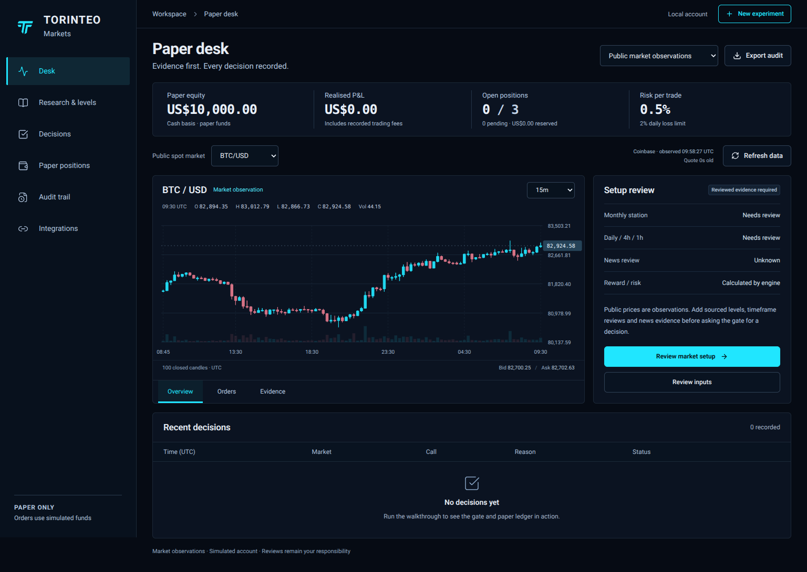

# Torinteo Markets

An owner paper-trading desk with a responsive React interface, a Python decision
engine and persistent SQLite experiments. Inspect real public candles, document
a setup, evaluate the evidence and follow simulated orders through fills, fees
and exits. The standard-library core also runs independently without an API key.

## Open the app

Use Python 3.11+ and Node 22.12+ (Node 24 is tested). From the repository root:

```sh
make setup
make run
```

Open **http://127.0.0.1:8787**. Choose **Start the walkthrough** for the complete
synthetic example, or **New experiment → Market observations** for Coinbase
public BTC/USD, ETH/USD and SOL/USD charts. The app stores accounts under
`runtime/web`; restarting with that directory preserves them.

The app includes Desk, Research & levels, Decisions, Paper positions, Audit trail
and Integrations screens. The walkthrough performs a real native-engine
approval, next-candle fill, conservative stop-first exit and a blocked setup.
Synthetic evidence is labelled throughout and isolated from market experiments.

Market observations do not supply research clearance. Enter sourced levels,
timeframe reviews and an economic-calendar review before evaluating a setup.
Quotes keep their provider timestamp; old observations need a refresh. Use
**Update paper fills** to process new closed one-minute candles for existing
market paper orders. There is no automatic background trading loop.



See [the web API and access guide](docs/WEB_API.md),
[public-data contract](docs/PUBLIC_MARKET.md), and
[web verification](docs/WEB_APP_VERIFICATION.md).

### Container launch

A persistent-volume container definition is included. Set a securely generated
owner token in your shell or secret manager, then run:

```sh
docker compose up --build -d
```

`TORINTEO_WEB_TOKEN` must contain at least 32 non-whitespace characters. The
Compose configuration publishes only on localhost and retains accounts in the
`markets-data` volume. Remote hosting needs HTTPS and explicit host/proxy
configuration, as described in the access guide. The SQLite service cannot run
on ephemeral Vercel function storage; no hosted account backend is implied.

**The runnable execution path is the native paper simulator.** OpenBB,
TradingAgents and Jev have optional adapters tested with injected contract
fixtures. Those checks do not establish installed upstream packages, working
provider credentials, real model latency or trading performance.

Repository: [Torinteo-ai/torinteo-markets](https://github.com/Torinteo-ai/torinteo-markets),
GitHub ID `1238002647`. The owner app and native paper engine are developed on `main`.
The repository rename was confirmed on 19 October 2026.

## Run the Python core directly

Use Python 3.11 or later from the directory containing `torinteo_paper`.

```sh
python3 -m torinteo_paper doctor
python3 -m torinteo_paper demo --db /tmp/torinteo-demo.sqlite3
python3 -m torinteo_paper audit --db /tmp/torinteo-demo.sqlite3
```

`doctor` checks local readiness without contacting providers or printing secret
values. `demo` requires a **fresh database path** and uses labelled synthetic
prices and research context. Its results demonstrate program behaviour, not a
market opportunity, historical strategy return or a real account position.

Run all core, adapter and HTTP tests after `make setup`:

```sh
make test
```

Browser checks target a disposable loopback server; see the web verification guide.

## Work with market evidence

The web app uses the built-in public Coinbase adapter. The command-line
`collect` action below is the separate optional OpenBB path: review and pin a
compatible installation first. The core does not install OpenBB automatically.
Replace the example dates with the range you need.

```sh
python3 -m torinteo_paper collect --symbol BTC/USD --asset-class crypto --start-date 2026-10-01 --end-date 2026-10-19 --out candles.json
python3 -m torinteo_paper assemble --candles candles.json --context context.json --out snapshot.json
python3 -m torinteo_paper evaluate --snapshot snapshot.json --db market.sqlite3
python3 -m torinteo_paper advance --bar bar-envelope.json --db market.sqlite3
python3 -m torinteo_paper audit --db market.sqlite3
```

`collect` returns a current retrieval with its actual completion time. It does
not turn downloaded historical prices into a point-in-time archive.
`assemble` requires operator-supplied quote, source references, reviewed levels,
timeframe reviews and news review; it does not invent those inputs. The final
setup snapshot uses closed 15-minute bars.

See the [input guide and examples](docs/INPUTS.md) for the collection,
context, snapshot and execution-bar fields. `evaluate` accepts current market
evidence and uses the actual clock. An approved decision creates a pending paper
order; a later execution bar is required for a fill.

For an explicitly historical or synthetic snapshot:

```sh
python3 -m torinteo_paper replay --snapshot snapshot.json --db replay.sqlite3
```

`replay` evaluates at the snapshot's event time and does not call online research
providers. Feed subsequent, correctly labelled bars through `advance` to
simulate execution and settlement. A single replay evaluation is not a full
strategy backtest.

## Experiment rules

- Keep market, historical and synthetic runs in separate databases. Submit
  observations in chronological order; late events cannot rewrite processed
  state. Open positions require continuous execution bars.
- Prices and P&L use the paper account's currency. An instrument's quote
  currency must match it exactly. USD and USDT are different; no currency
  conversion is implemented.
- New databases use the validated default configuration unless `--config
  config.json` is supplied. Existing databases use their persisted settings when
  the flag is omitted. Any explicitly supplied configuration must match the
  stored configuration; use a fresh database for changed experiment settings.
- The default risk day is `Europe/London`. Daily cashflows include entry fees
  when incurred and exit settlements when observed. Account equity is based on
  those realised cashflows, not a marked-to-market valuation of open positions.

Configuration fields and default limits are described in
[the design](docs/DESIGN.md#paper-risk-and-accounting). Defaults are paper
engineering choices, not claims of profitable or suitable risk settings.

## What is included

| Component | Implemented boundary |
| --- | --- |
| Owner web app | Responsive charts, reviewed evidence forms, isolated experiments, full decisions/orders/audit, owner access and persistent disk storage. |
| Public Coinbase data | Actual public OHLCV and bid/ask for three fixed USD spot pairs; strict timestamps, closed-candle checks and no fabricated fallback. |
| Native engine and ledger | Evidence validation, breakout/retest checks, risk checks, pending orders, simulated next-bar fills, stop/target settlement, restartable audit. |
| OpenBB adapter | Explicit instrument mapping and closed-candle checks; real provider activation remains unverified. |
| TradingAgents adapter | Current-day research with completion timestamps and strict ratings; no historical intraday guarantee or order authority. |
| Jev adapter | Typed optional entry assessment; disabled, shadow and required modes. A required failure blocks entry. |
| Freqtrade boundary | Dry-run entry-confirmation mixin and local ticket checks only. A complete host strategy, protection and external-account reconciliation are unfinished. |
| QuantDinger | Reviewed as an alternative host; not implemented or deployed here. Its client UI has separate source-available licensing. |
| jev-trader | Reviewed reference; its market-making strategy was not adopted. |

Major monthly/historical reaction levels and the wider review context are
operator-supplied. Automatic discovery of those levels and a separate
rejection/structure-break setup are not implemented. No live broker, continuous
market watcher or external account connection is supplied by the native demo.

## Further documentation

- [Owner web API, authentication and persistent storage](docs/WEB_API.md)
- [Public Coinbase data and native fill synchronization](docs/PUBLIC_MARKET.md)
- [Web app design](docs/WEB_APP_DESIGN.md)
- [Web app verification](docs/WEB_APP_VERIFICATION.md)
- [Input guide and runnable examples](docs/INPUTS.md)
- [Local verification and remaining integration limits](docs/VERIFICATION.md)
- [Design and JSON contracts](docs/DESIGN.md)
- [Implementation and activation plan](docs/IMPLEMENTATION_PLAN.md)
- [Upstream sources, versions and limitations](docs/UPSTREAMS.md)
- [Jev request and response contract](docs/JEV.md)
- [Freqtrade boundary and missing host lifecycle](docs/FREQTRADE.md)
